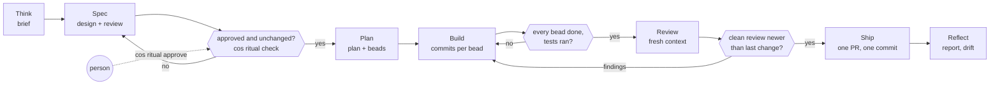

# ritual, zero to hero

From a fresh machine to a shipped change, run as one flow. Two skills in this repo do it:
[`ritual`](../skills/ritual/SKILL.md) (lean) and [`ritual-full`](../skills/ritual-full/SKILL.md)
(every tool on). This guide installs everything, then walks one toy feature through both.

Commands here were checked on macOS against `cn` (Chronis 0.9.3) and `cos` 0.3.0. Linux steps
follow each tool's own install docs and were not run on Linux for this guide.

## 1. What ritual is

Planned work goes through seven steps. Each step writes a file and names it on a **Chronis epic**,
the flow's anchor, so any session (or `cos flows`) can read where the flow is from the epic alone.
Gates sit between steps, and exactly one of them waits on a person: approving the design.



- **One flow, one epic.** The epic's description carries `ritual-<key>: <value>` lines; the newest
  line of each key wins.
- **A file per step.** Brief, design, design review, plan, code review, PR, report. Each lives in
  the repo, under `docs/plans/` or `docs/reports/`, and is indexed.
- **Gates.** Spec to Plan needs an approved, unchanged design. Build to Review needs every bead
  done and tests run. Review to Ship needs a clean fresh-context review newer than the last change.
- **One human approval.** A person approves the design. Nothing else in the flow waits on a
  person.

## 2. Two flavours

| | `ritual` | `ritual-full` |
|---|---|---|
| Required | `cn` | `cn`, EGM, semantic-isa, `cos`, graphify, claude-guard, and the `brainstorming`, `pr-proof`, `systematic-debugging` skills |
| Missing optional tool | that path is skipped | preflight stops and prints the install command; the user may say "continue without X" |
| Design | decision, context, design, alternatives, security, testing, confidence, acceptance | the same plus a mandatory **Semantic ISA** section |
| Design review | one fresh-context reviewer | two: `/egm:egm-review` and a hired `ritual-goldfish` |
| Build and Review | in session or hired | hired `builder` and `reviewer` per bead |

Pick `ritual` for small repos or a first run. Pick `ritual-full` when the change has side effects
worth naming (files, network, APIs, messages, deploys, data writes).

## 3. Install from zero

One command per line. Each block ends with a check and the output it should show.

### 3.1 Rust toolchain

From [rustup.rs](https://rustup.rs):

```sh
curl --proto '=https' --tlsv1.2 -sSf https://sh.rustup.rs | sh
cargo --version
```

Expect `cargo 1.x.y (…)`.

### 3.2 Claude Code and gh

Install Claude Code per its [setup docs](https://code.claude.com/docs/en/setup) and the GitHub CLI
per [cli.github.com](https://cli.github.com), then log in to both:

```sh
claude --version
gh auth status
```

Expect a version string and `Logged in to github.com`.

### 3.3 Chronis (`cn`), required

[crates.io/crates/chronis](https://crates.io/crates/chronis): "Event-sourced task CLI powered by
the AllSource embedded database".

```sh
cargo install chronis
cn --help
```

Expect `Chronis — the agent-native task CLI. Event-sourced, TOON-optimized.` and a command list
including `init`, `task`, `ready`, `claim`, `done`, `approve`, `dep`, `migrate-beads`. `cn` has no
`--version` flag. Then, once per repo, in its main checkout:

```sh
cn init --toon
```

Expect `Initialized chronis workspace in <repo>/.chronis`.

### 3.4 This repo's skills

```sh
git clone https://github.com/decebal/decebal-claude-skills ~/src/decebal-claude-skills
```

Copy the skills the flow uses (run from the clone):

```sh
cp -R skills/ritual ~/.claude/skills/ritual
cp -R skills/ritual-full ~/.claude/skills/ritual-full
cp -R skills/semantic-isa ~/.claude/skills/semantic-isa
cp -R skills/brainstorming ~/.claude/skills/brainstorming
cp -R skills/pr-proof ~/.claude/skills/pr-proof
cp -R skills/systematic-debugging ~/.claude/skills/systematic-debugging
ls ~/.claude/skills
```

Expect the six names in the listing. semantic-isa's DESIGN mode also borrows `arch`,
`security-review`, `rust-clean-architecture` and `integration-test`; copy them the same way if you
want those steps. To link every skill at once instead, see [skillsync](skillsync.md)
(`skillsync skills install`).

### 3.5 EGM plugin

From the [EGM README](https://github.com/google/elephant-goldfish-model#install) ([egm.dev](https://egm.dev)):

```sh
claude plugin marketplace add google/elephant-goldfish-model
claude plugin install egm@egm
claude plugin list
```

Expect an `egm@egm` entry with `Status: ✔ enabled`. Start a new session. Its seven skills are
`/egm:egm-brainstorm`, `/egm:egm-draft`, `/egm:egm-review`, `/egm:egm-resolve`,
`/egm:egm-review-loop`, `/egm:egm-bootstrap` and `/egm:egm-drift-report`. They set
`disable-model-invocation: true`: you type them; the model cannot start them.

### 3.6 cos (chief of staff)

From the [chief-of-staff-v2 README](https://github.com/decebal/chief-of-staff-v2#install). Needs
Claude Code logged in, `gh`, Rust and [Task](https://taskfile.dev/installation/)
(`brew install go-task` on macOS).

```sh
git clone https://github.com/decebal/chief-of-staff-v2 ~/src/chief-of-staff-v2
```

Then, in the clone (`task setup` seeds `context/` and `.chief-of-staff/`, builds, and installs
`cos` into `~/.cargo/bin` and its agents into `~/.claude/agents`):

```sh
task setup
cos --version
cos ritual --help
```

Expect `cos 0.3.0` or later and the subcommands `check` and `approve`. `cos flows` needs the
`tasks` source approved in the workspace profile (set up with the starter kit's
`START-HERE.md`) and scans `--projects <dir>` (env `COS_PROJECTS`) for repos with `.chronis/`.
The cos README lists scheduling and opening reports as macOS-only; the ritual commands are plain
Rust and were not tried on Linux.

### 3.7 claude-guard

From this repo ([hooks/README.md](../hooks/README.md)), run in the clone:

```sh
cargo install --path gates/rust/claude-guard
cargo install --path gates/rust/skillsync
skillsync hooks install --dry-run
skillsync hooks install
```

Check that agent approval is blocked. This feeds the hook a payload and runs nothing:

```sh
printf '%s' '{"tool_name":"Bash","tool_input":{"command":"cn approve t-0"}}' | claude-guard infra-guard
```

Expect `"permissionDecision":"deny"` and a reason naming `cn approve`. Any other output means
your build does not carry that rule, and agent approval rests on the skill's instruction alone.

### 3.8 graphify

From the [graphify README](https://github.com/Graphify-Labs/graphify) (needs Python 3.10+ and
[uv](https://docs.astral.sh/uv/)):

```sh
uv tool install graphifyy
graphify install
graphify --help
```

Then build a repo's graph by typing `/graphify .` in Claude Code inside the repo; it writes
`graphify-out/`. Optional in `ritual`, on in `ritual-full`.

## 4. First flow, lean (`ritual`)

The toy: a `hello` CLI repo. The feature: `hello --share` posts the greeting to a webhook URL
from the config file and appends it to a local history file.

Ask Claude: "plan this feature: hello --share posts the greeting to the configured webhook".
The skill reports the step in one line (`ritual: hello <epic> is at think because no epic yet`)
and works through the steps below. The commands are what it runs; you type only the approval.

**Think.** It asks one question per message, writes
`docs/plans/2026-11-11-share-flag-brief.md`, and creates the epic in the main checkout:

```sh
cn task create "Share flag" --type epic --toon --description $'Post the greeting to the configured webhook.\n\nritual-brief: docs/plans/2026-11-11-share-flag-brief.md'
```

Output: `created:epic:t-561aed:Share flag` (ids are random).

**Spec.** It cuts the flow's branch in its own worktree, names it, drafts the design, has a
fresh-context reviewer write `…-design-review.md` with `verdict: clean`, and names the design:

```sh
git worktree add -b feat/share-flag ../hello-share-flag origin/main
cn task edit t-561aed --append-description "ritual-branch: feat/share-flag" --toon
cn task edit t-561aed --append-description "ritual-design: docs/plans/2026-11-11-share-flag-design.md" --toon
```

Each edit prints `ok:edited:t-561aed`. Then it shows you the design and the review and stops. You
approve in your own terminal:

```sh
cos ritual approve t-561aed docs/plans/2026-11-11-share-flag-design.md --by "Your Name" --review docs/plans/2026-11-11-share-flag-design-review.md
```

It asks for `yes`, appends `ritual-approved: <path> sha256:<hex> by Your Name` and runs
`cn approve`. Without `cos`: `shasum -a 256 <design>`, append the same line yourself, then
`cn approve t-561aed`.

**Plan.** The gate first; before approval it prints `unapproved` and exits 1:

```sh
cos ritual check t-561aed
```

Exit 0, then it writes `…-plan.md`, names it (`ritual-plan:`), and cuts beads as a graph:

```sh
cn task create "US-001: read webhook URL from config" --parent t-561aed --priority p1 --toon --description "As a user ..."
cn task create "US-002: post greeting on --share" --parent t-561aed --priority p1 --blocked-by <US-001 id> --toon --description "As a user ..."
cn ready --toon
```

Only US-001 is ready; US-002 shows `blocked_by` US-001.

**Build.** Per ready bead: `cn claim <id> --toon`, test first, code, test green, commit on
`feat/share-flag`, then `cn done <id> --toon --reason "<commit, test command, result>"`.

**Review.** A fresh-context reviewer reads the design, the diff and the repo, runs the feature,
and writes `…-code-review.md`: `ritual-review: docs/plans/2026-11-11-share-flag-code-review.md clean`.

**Ship.** One commit, `pr-proof` evidence, one PR: `ritual-pr: <url>`. After the merge:
`ritual-shipped: <merge commit>`.

**Reflect.** `docs/reports/2026-11-11-share-flag.md`, `ritual-report: <path>`, then
`cn done t-561aed --toon --reason "Shipped in <PR>; report at <path>"`.

At the end `cn show t-561aed --toon` reads like this (the description is one line with `\n`
escapes; wrapped here):

```text
id:t-561aed
type:epic
title:Share flag
description:Post the greeting to the configured webhook.\n\nritual-brief: docs/plans/2026-11-11-share-flag-brief.md
  \nritual-branch: feat/share-flag\nritual-design: docs/plans/2026-11-11-share-flag-design.md
  \nritual-approved: docs/plans/2026-11-11-share-flag-design.md sha256:<hex> by Your Name
  \nritual-plan: docs/plans/2026-11-11-share-flag-plan.md
  \nritual-review: docs/plans/2026-11-11-share-flag-code-review.md clean
  \nritual-pr: https://github.com/<you>/hello/pull/1\nritual-shipped: <merge commit>
  \nritual-report: docs/reports/2026-11-11-share-flag.md
priority:p2
status:done
---
[id|status|title]
<id>|done|US-001: read webhook URL from config
<id>|done|US-002: post greeting on --share
[timestamp|event_type]
…|task.created
…|task.updated
```

The lines through `ritual-design:`, the bead table and `cos ritual check` printing `unapproved`
were observed in a scratch repo; the later lines follow the same `--append-description` form.

## 5. Same flow, `ritual-full`

Ask: "ritual full: hello --share posts the greeting to the configured webhook". Differences:

1. **Preflight** prints one line, for example
   `preflight: cn ok · egm ok · semantic-isa ok · cos ok · graphify missing (uv tool install graphifyy) · claude-guard ok · skills ok`,
   and stops until graphify is installed or you say "continue without graphify".
2. **Think.** You run `/egm:egm-brainstorm`; Claude runs `graphify query` on the config and HTTP
   modules. `concepts_brief.md` moves to the dated brief path.
3. **Spec.** You run `/egm:egm-draft`; `design_draft.md` moves to the dated design path and gains
   the Semantic ISA section (below). Two reviews in separate contexts: you run
   `/egm:egm-review docs/plans/2026-11-11-share-flag-design.md`, and Claude hires a Goldfish with
   `cos agents spawn --role ritual-goldfish --repo ../hello-share-flag --prompt "Review docs/plans/2026-11-11-share-flag-design.md"`.
   (The role exists in cos's `templates/context/agents.json`; this hire was not run for this
   guide.) Findings go through `/egm:egm-resolve`; both reviews are re-run until clean on the same digest;
   then `cos ritual check` and your `cos ritual approve`.
4. **Plan.** Each sink gets a bead whose done-when is its VERIFY test.
5. **Build and Review.** `cos agents spawn --role builder` per ready bead and
   `cos agents spawn --role reviewer` for the review; the reviewer confirms each sink's VERIFY in
   code.
6. **Reflect.** You run `/egm:egm-drift-report docs/plans/`; any new sink goes in the report and the
   design.

The ISA section for the toy:

```markdown
## Semantic ISA

### Side-effect inventory
| Capability | System | Reversible? | Affected if it misfires |
|---|---|---|---|
| append to ~/.hello/history | local file | yes (edit file) | the user |
| POST greeting to webhook | network | no | whoever reads the webhook's channel |

### Instructions
| Instruction | Core | Governance property | Sink? |
|---|---|---|---|
| `LOAD(config.webhook_url)` | Memory | Deterministic I/O | no |
| `STORE(history.append)` | Memory | Deterministic I/O | no |
| `VERIFY(webhook_allowed)` | Normative | Deterministic checkpoint | no |
| `VERIFY(name_shape)` | Normative | Deterministic checkpoint | no |
| `TOOL_CALL(webhook.post)` | Execution | Terminal action | **yes** |

Binding for the sink: `{ url: string (https), text: string (max 200) }`, `additionalProperties: false`.

### Taint and sinks
Sources: `--name` (user input), the config file (user-editable). Sink: `TOOL_CALL(webhook.post)`.

| Sink | Cleared by | Check |
|---|---|---|
| `TOOL_CALL(webhook.post)` | `VERIFY(webhook_allowed)` + `VERIFY(name_shape)` | URL scheme is https and host is in `share.allowed_hosts`; name matches `^[A-Za-z .'-]{1,40}$` |

### Violations
| Violation | Evidence | Recovery |
|---|---|---|
| host not allowed | host, config path | exit 2, print the allowed hosts; nothing sent |
| name fails shape | the rejected name | exit 2; history not written |

### ISA test matrix
| Case | Expectation |
|---|---|
| allowed host, valid name | one POST, one history line |
| http URL or unlisted host | refused, no POST |
| name with control characters | refused, no POST, no history line |
```

A change with no side effects writes one line instead, with the evidence: `No side effects: the
diff touches only src/format.rs (pure string formatting).`

## 6. Gates and the human approval

| Gate | Blocks | Checked by |
|---|---|---|
| Spec → Plan | cutting beads | `cos ritual check <epic>` exits 0: approved, and the design's sha256 equals the newest `ritual-approved:` digest |
| Build → Review | review | every bead done; the tests ran (a compile, lint or `--no-run` build is not a test run) |
| Review → Ship | the PR | a fresh-context review, newer than the last change, says `clean` |
| Ship | merge | one PR, one commit, test plan ticked |

Agents cannot approve because the approval is what makes the design a decision rather than the
author's opinion of its own work. Three layers hold that line:

- the skills tell agents never to run `cn approve` or `cos ritual approve`;
- `cos ritual approve` asks for `yes` on a terminal and refuses when stdin is not one;
- claude-guard's infra-guard denies both commands in agent Bash calls (check it, section 3.7).

The cos docs state the limit: `--by` is a name, not an identity, and a call hidden behind a
variable, `eval` or a script gets past the hook ([cos ritual docs](https://github.com/decebal/chief-of-staff-v2/blob/main/docs/ritual.md#what-approval-does-and-does-not-stop)).

## 7. Per-organisation notes

Repos in one organisation share facts the flow must respect: version pins, ticket keys, release
paths, CI-only steps. Keep them in `~/.claude/skills/ritual/references/<org>.md`, shaped as
[repo-notes.md](../skills/ritual/references/repo-notes.md) describes, and the skill reads it before
Build and Ship. The repo's own `CLAUDE.md` wins over it. A fictional example:

```markdown
# Acme notes

| | |
|---|---|
| Runtime | Bun, pinned in `packageManager`; Rust pinned in `rust-toolchain.toml` |
| Monorepo | Turborepo; `bun run ci` at the root |
| Tests and lint | `bun test` locally; e2e only in CI (`e2e.yml`) |
| Ticket key | `ACME-123` in the branch (`feat/ACME-123-share-flag`) and the PR title (`feat(ACME-123): …`) |
| Tracker | `.chronis/`; old `.beads/` in `acme-api`, migrate first |
| Release path | tags build in CI; signing runs only in CI with the release environment's secrets |
| Infra | Terraform in `infra/`; deploys authenticate through CI OIDC, never a laptop |
```

## 8. Troubleshooting

| Symptom | Cause | Fix |
|---|---|---|
| `cn show <epic>` says not found in a worktree; `cn list` is empty | each linked worktree has its own untracked `.chronis/` | run `cn` from the main checkout; check `git rev-parse --git-common-dir` and `--git-dir` print the same directory |
| `cos ritual check` prints `changed since approval` | the design's bytes changed after approval (drift) | back to Spec: new review on the new digest, new `cos ritual approve`. Keep the plan in its own file so planning never edits the design |
| `cos ritual check` prints `missing design` | no `ritual-design:` line, or the file is not on the flow's branch | commit the design on the branch and append the line |
| Claude says it cannot run `/egm:egm-review` | EGM skills set `disable-model-invocation: true` | type the command yourself; Claude waits for the output file |
| `/egm:` commands not found | plugin missing, or session started before install | `claude plugin list`; install per 3.5; start a new session |
| ritual-full preflight stops on a tool | default-on means missing blocks | install with the printed command, or say "continue without <tool>" |
| `cn task create` errors `unexpected argument '- '` | a description starting with `-` reads as a flag | `--description="- [ ] …"` or start the text with words |
| repo has `.beads/` and no `.chronis/` | legacy beads tracker | `cn migrate-beads --toon`, then verify with `cn list --toon` before Plan |
| `cos flows` shows nothing | `tasks` source not approved in the cos profile, or the repo is not directly under `--projects` | approve the source per `START-HERE.md`; pass `--projects <dir>` |

## 9. Glossary

| Term | Meaning |
|---|---|
| epic | the Chronis task of `--type epic` that anchors one flow and carries its `ritual-*` lines |
| bead | one story under the epic: a Chronis task an agent can finish in one session |
| ready set | open beads with nothing blocking them: `cn ready --toon` |
| Elephant | the author with the full context, who drafts the brief and design (EGM's term) |
| Goldfish | a reviewer with no memory of the author's conversation: only the document and the code |
| drift | the design no longer matches what was approved, or the code no longer matches the design |
| sink | an Execution instruction where tainted data must never arrive unchecked: an outbound message, a payment, a delete, a write to a shared system |
| taint | the mark on data from an untrusted source (user input, fetched content, model output) and anything computed from it |
| VERIFY | a deterministic, stated check that clears taint before a sink; "the model judged it safe" is not one |

Further reading: [ritual](../skills/ritual/SKILL.md), [ritual-full](../skills/ritual-full/SKILL.md),
[semantic-isa](../skills/semantic-isa/SKILL.md), [EGM getting started](https://github.com/google/elephant-goldfish-model/blob/main/docs/getting_started.md),
[cos ritual flows](https://github.com/decebal/chief-of-staff-v2/blob/main/docs/ritual.md).
